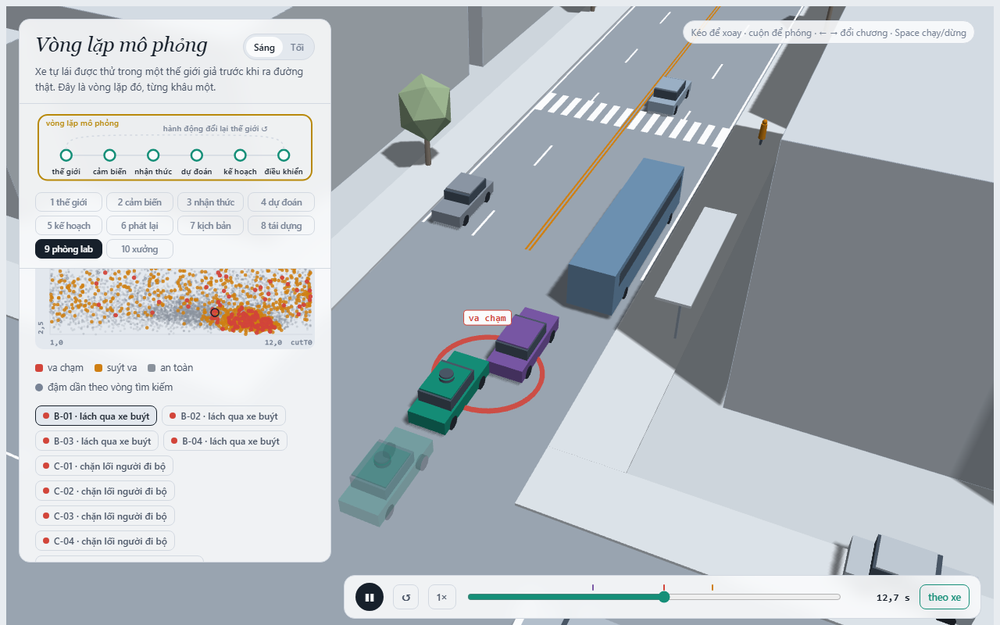
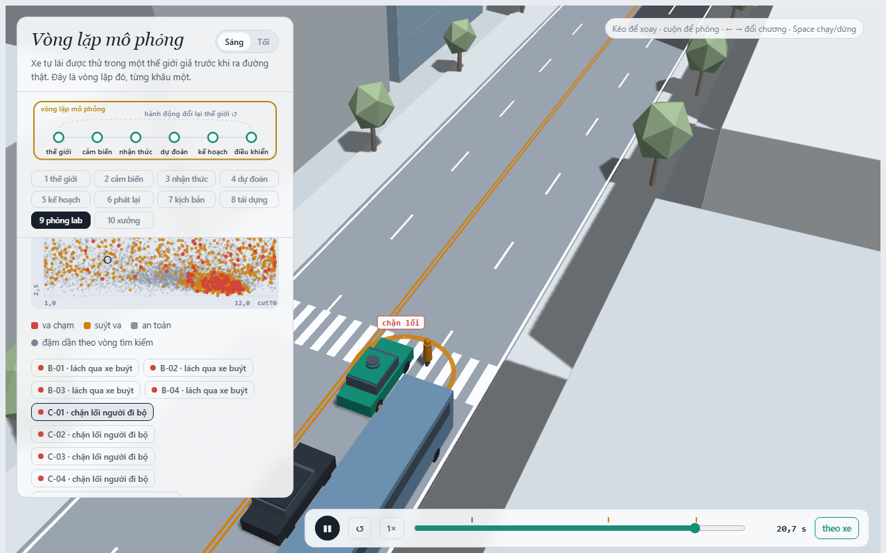
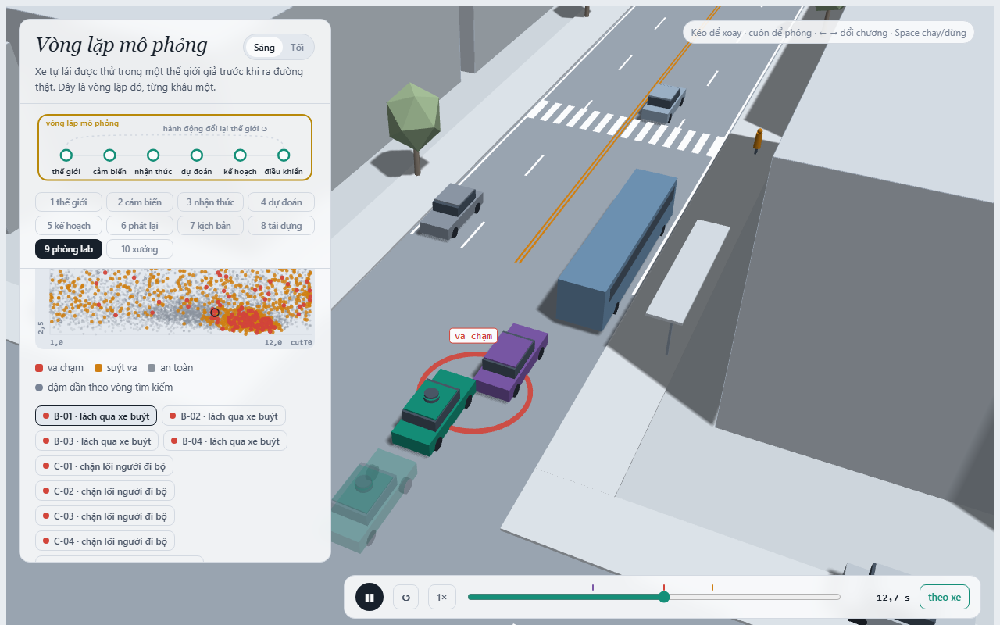
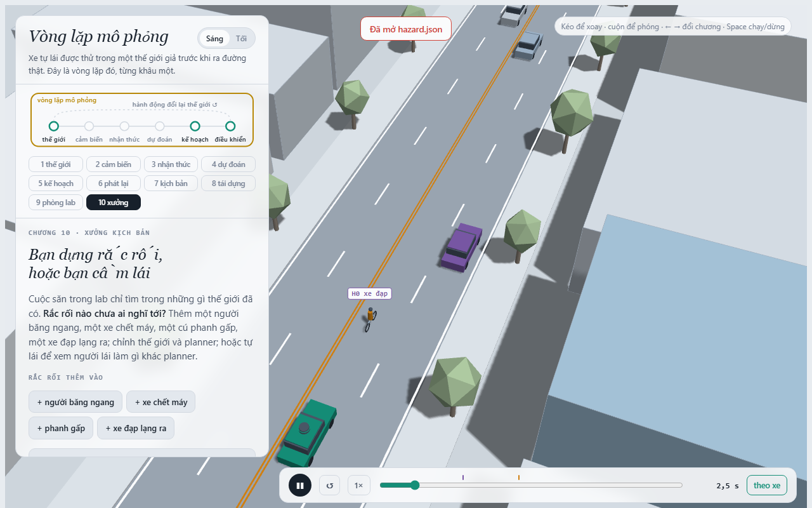

MSSV: 202602394

# Lab 11 · Scenario Forge — báo cáo

Mỗi câu: trả lời ngắn, **trích số từ `evidence/`** (ghi tên file và trường, ví dụ `mc.json: crashes = 4`). Grader chạy lại với MSSV của bạn; số không khớp `evidence/` thì mất điểm phần D (RUBRIC), và câu dựa trên số sai khó được điểm đầy đủ. Không cần văn hay: một bảng nhỏ và hai, ba câu giải thích là đủ.

Thị trấn của bạn (`meta.json: _run.town`): **Town D**

## 1. Phát lại log có trung thực không? (bước A)

### Bảng số liệu (`evidence/replay.json`)
| Trường dữ liệu | Giá trị | Chi tiết |
|---|---|---|
| `dropped_human_crash_logs` | **1** | Bị loại vì người lái trong log gây va chạm |
| `n_used` | **399** | Số log hợp lệ được đưa vào mô phỏng |
| `replay.crashes` | **90** | Va chạm khi phát lại log (`rear`: 88, `side`: 2) |
| `reactive.crashes` | **0** | Va chạm trong thế giới phản ứng (`contact`: {}) |
| `crash_in_both` | **0** | Không có kịch bản nào va chạm ở cả hai thế giới |

### Giải thích bản chất va chạm giả (`rear`)
Phần lớn va chạm ở chế độ phát lại là va chạm từ phía sau (`rear` = 88/90). Đây hoàn toàn là **va chạm giả** do bản chất của *open-loop replay*:
- Các phương tiện khác trong log phát lại (đặc biệt là xe bám đuôi `TG`) chỉ tua lại toạ độ cứng đã ghi nhận trong quá khứ mà không hề có nhận thức hay phản xạ với ngoại cảnh.
- Khi planner của xe ta (`ego`) điều khiển xe thận trọng, xe ta phanh sớm hơn người lái con người trong log (ví dụ khi nhường đường cho người đi bộ qua đường). Do xe đuôi `TG` trong log không biết xe ta phanh sớm, nó tiếp tục lao tới theo quỹ đạo cũ và đâm vào đuôi xe ta.
- Trong thế giới phản ứng (*reactive simulation*), xe `TG` được điều khiển bởi mô hình bám đuôi phản ứng (IDM). Khi xe ta phanh, `TG` phản xạ phanh theo và duy trì cự ly an toàn, dẫn đến **0 va chạm**.

### Kịch bản cụ thể trong `replay_only`
Chọn kịch bản `scenario: 1` (`contact: "rear"`, `min_ttc_reactive: 2.7455s`):
- Tham số kịch bản: `pedT0 = 5.06s`, `cutT0 = 8.03s`, `busGo = 16.13s`, `tgT = 1.49s`, `cutGap = 18.86m`, `pedGap = 3.61m`, `mu = 0.8`.
- Diễn biến: Tại $t \approx 5.06\text{s}$, người đi bộ `P1` xuất hiện tại vạch sang đường. Xe ta nhận diện và chủ động phanh giảm tốc an toàn trước vạch. Trong chế độ phát lại, xe `TG` giữ nguyên vận tốc cũ và đâm vào đuôi xe ta tại $t \approx 14.5\text{s}$. Trong khi đó ở thế giới phản ứng, `TG` phản ứng giảm tốc cùng xe ta, khoảng cách luôn an toàn với $\text{min TTC} = 2.75\text{s}$.

---

## 2. Kịch bản bất khả thi (bước B)

### Các luật trong `is_feasible` và căn cứ vật lý
1. **Gia tốc ngang khi chuyển làn:** $a_{\text{lat}} = \left(\frac{\pi}{\text{cutDur}}\right)^2 \cdot 1.75 \le \mu g$
   - *Căn cứ:* Quỹ đạo chuyển làn ngang dạng hàm cosine có biên độ nửa làn $A = 1.75\text{ m}$. Đạo hàm bậc hai cho gia tốc ngang cực đại là $A \omega^2 = 1.75 (\pi / \text{cutDur})^2$. Lực ma sát bám ngang của lốp bị giới hạn bởi $\mu g$. Nếu vượt quá ngưỡng này, xe sẽ bị trượt văng khỏi làn.
2. **Gia tốc phanh sau nhập làn:** $\text{cutBrake} \le \mu g$
   - *Căn cứ:* Lực phanh cực đại của lốp trên mặt đường bị giới hạn bởi định luật ma sát Coulomb $F_{\text{friction}} = \mu m g \implies a_{\text{brake}} \le \mu g$. Phanh lớn hơn $\mu g$ là phi thực tế vì bánh xe sẽ bị bó cứng và trượt lết.
3. **Vận tốc người đi bộ:** $\text{pedV} \le 2.5\text{ m/s}$
   - *Căn cứ:* Giới hạn vận tốc chạy nước rút tối đa của người đi bộ thông thường trong đô thị; vượt quá $2.5\text{ m/s}$ ($9\text{ km/h}$) là phi nhân tính trong ngữ cảnh người đi bộ qua đường.
4. **Vận tốc xe cắt làn:** $0 < \text{cutV} \le 22.0\text{ m/s}$
   - *Căn cứ:* Phương tiện trong đô thị không thể chạy giật lùi ($\text{cutV} > 0$) và không vượt quá tốc độ giới hạn tối đa ($22\text{ m/s} \approx 79.2\text{ km/h}$).

### Số liệu từ `evidence/hunt.json`
| Cuộc săn | Số va chạm tìm thấy (`found`) | Số kịch bản bất khả thi (`infeasible`) |
|---|---|---|
| `bus_bypass` | 136 (`bus_bypass`) | 1 |
| `cut_in` | 28 (`bus_bypass` - drift) | 1 |
| `crosswalk_block` | 73 (`crosswalk_block`) | **36** (nhiều nhất) |
| `rear_ended` | 2 `bus_bypass`, 1 `crosswalk_block` | 11 |

- **Vì sao CEM bị kéo về phía bất khả thi:** Hàm mục tiêu nguy hiểm (danger score / fitness) thưởng điểm số tối đa cho các kịch bản có khoảng cách tối thiểu nhỏ hoặc va chạm xảy ra. Những tham số vi phạm vật lý (như xe cắt làn đánh lái giật cục với $\text{cutDur}$ cực ngắn hoặc phanh gấp $\text{cutBrake} \gg \mu g$) tạo ra các tình huống cực kỳ hung hãn và gần như bất khả kháng cho xe ta, từ đó tối đa hóa điểm số nguy hiểm. Do đó, nếu không có bộ lọc `is_feasible`, thuật toán tối ưu hoá phân phối CEM sẽ bị hút mạnh về các vùng tham số siêu thực này.
- **Hệ quả nếu đếm chúng là va chạm:** Xác suất tai nạn sẽ bị **thổi phồng nghiêm trọng (overestimate)**. Ta sẽ lãng phí tài nguyên để khắc phục những tình huống không thể xảy ra ngoài đời, đồng thời làm sai lệch phân phối quan trọng (IS).

---

## 3. Monte Carlo cho bạn biết gì (bước C1)

### Số liệu từ `evidence/mc.json`
- Số lần chạy ($n$): **3000**
- Số va chạm ($k$): **0**
- Tỷ lệ ước lượng ($\hat{p}$): **0.0**
- Khoảng tin cậy Wilson 95 %: $[1.08 \times 10^{-19}, 1.28 \times 10^{-3}]$ (tức $[0, 0.00128]$)
- Số mẫu infeasible bị loại: 11

### Số lần chạy để khoảng tin cậy hẹp còn $\pm 20\%$ của $p$
Với mức ý nghĩa $95\%$ ($z \approx 1.96$) và sai số tương đối $\epsilon = 0.2$:
$$n \approx \frac{z^2}{\epsilon^2 \cdot p} \approx \frac{1.96^2}{0.2^2 \cdot p} \approx \frac{96}{p}$$
Từ kết quả Importance Sampling ở Bước C3, xác suất va chạm thực sự của Town D là $p \approx 5.84 \times 10^{-4}$ (trung vị `total`). Khi đó số lần chạy cần thiết là:
$$N \approx \frac{96}{5.84 \times 10^{-4}} \approx \mathbf{164,384 \text{ lần chạy}}$$

### Kiểu thất bại chưa xuất hiện và con số đúng cần báo
- Trong 3 000 lần chạy của `mc.json`, **tất cả** các kiểu thất bại (`bus_bypass`, `cut_in`, `crosswalk_block`, `rear_ended`, `other`) đều có $k = 0$ (chưa hề xuất hiện).
- **Con số đúng cần báo:** Tuyệt đối không được báo bằng $0$. Con số đúng theo quy tắc khoa học là **cận trên của khoảng tin cậy 95%**, tức cận trên Wilson **$1.28 \times 10^{-3}$** (hoặc xấp xỉ Rule of Three $3/n = 3/3000 = 1.0 \times 10^{-3}$).

---

## 4. Importance sampling, ESS và độ suy biến (bước C3)

### Bảng số liệu (`evidence/estimate.json`)
Ngân sách tính toán: `budget = 16800`.

| Seed | Kiểu thất bại | $\hat{p}$ | Hits ($/600$) | ESS | Top Share | Cận trên 0-hits |
|---|---|---|---|---|---|---|
| **0** | `bus_bypass` | $8.96 \times 10^{-4}$ | 31 | 132.7 | 0.206 | – |
| | `cut_in` | $0.0$ | 0 | 120.0 | 0.0 | 0.025 |
| | `crosswalk_block` | $5.18 \times 10^{-7}$ | 93 | 113.0 | **0.613** | – |
| | `rear_ended` | $0.0$ | 0 | 121.6 | 0.0 | 0.025 |
| | **Total** | $8.97 \times 10^{-4}$ | | | | |
| **1** | `bus_bypass` | $5.84 \times 10^{-4}$ | 35 | 115.9 | 0.196 | – |
| | `cut_in` | $0.0$ | 0 | 113.8 | 0.0 | 0.025 |
| | `crosswalk_block` | $3.05 \times 10^{-7}$ | 81 | 112.2 | 0.450 | – |
| | `rear_ended` | $0.0$ | 0 | 123.5 | 0.0 | 0.025 |
| | **Total** | **$5.84 \times 10^{-4}$** | | | | |
| **2** | `bus_bypass` | $2.80 \times 10^{-4}$ | 32 | 121.9 | 0.129 | – |
| | `cut_in` | $0.0$ | 0 | 110.1 | 0.0 | 0.025 |
| | `crosswalk_block` | $8.84 \times 10^{-7}$ | 105 | 138.3 | 0.349 | – |
| | `rear_ended` | $0.0$ | 0 | 114.1 | 0.0 | 0.025 |
| | **Total** | $2.80 \times 10^{-4}$ | | | | |

- **Độ nhất quán giữa 3 seed và so với Monte Carlo:**
  - Ba seed hoàn toàn đồng ý về bậc độ lớn: `bus_bypass` là kiểu lỗi chủ đạo ($p \approx 2.8 - 8.9 \times 10^{-4}$, trung vị là **$5.84 \times 10^{-4}$**); `crosswalk_block` là lỗi cực hiếm ($p \approx 3.0 - 8.8 \times 10^{-7}$); `cut_in` và `rear_ended` đều không có va chạm.
  - Đồng ý với Monte Carlo: Trung vị tổng xác suất thất bại $5.84 \times 10^{-4}$ nằm hoàn toàn bên trong khoảng tin cậy 95% của MC $[1.08 \times 10^{-19}, 1.28 \times 10^{-3}]$.
- **Vị trí `top_share` lớn (> 0.5) và bản chất suy biến:**
  - `top_share` lớn hơn 0.5 xảy ra ở chế độ `crosswalk_block` tại **Seed 0** (`top_share = 0.613`, tức 61.3%).
  - *Giải thích:* Đây là hiện tượng suy biến trọng số (*weight degeneracy*). Dù có hỗn hợp phòng thủ ($\beta = 0.2$), trong 93 mẫu va chạm vẫn có một mẫu rơi vào vùng có tỷ số hợp lý $w = p(x)/q(x)$ rất lớn, khiến riêng mẫu này gánh tới 61.3% toàn bộ ước lượng xác suất của mode đó.
- **So sánh ngân sách (`budget`) với Monte Carlo:**
  - Ngân sách IS là **16 800** lần chạy. Để đạt độ chính xác tương đương ($\pm 20\%$) cho biến cố $p \approx 5.84 \times 10^{-4}$, Monte Carlo cần $\approx 164 000$ lần chạy (gấp gần 10 lần). Với mode hiếm $p \sim 10^{-7}$, MC cần hàng trăm triệu lần chạy.
- **Phần `other`:** Lấy từ `evidence/mc.json` ($k=0, n=3000, p=0.0, hi=0.0012789$). Không săn `other` vì nó không có đặc trưng hình học xác định để định hướng hàm fitness; lấy mẫu ngẫu nhiên từ phân phối tự nhiên là phương pháp không thiên lệch duy nhất.

---

## 5. Các kiểu thất bại (bước C2 + 3D)

### Kiểu 1: `bus_bypass`

- **Chuỗi sự kiện (Run `B-01`):** Xe buýt `BUS` dừng trả khách ở làn trong che khuất xe `C2` đang đi ở làn ngoài. Khi xe ta `ego` lách qua xe buýt, xe `C2` bất ngờ cắt làn tạt đầu vào làn của xe ta tại $t = 12.65\text{s}$. Do tầm nhìn bị xe buýt che chắn và khoảng cách quá ngắn, xe ta nhận diện `C2` muộn và phanh không kịp, dẫn đến va chạm góc/thân xe.

### Kiểu 2: `crosswalk_block`

- **Chuỗi sự kiện (Run `C-01`):** Người đi bộ `P1` băng qua đường tại vạch sang đường bị thân xe buýt che khuất hoàn toàn. Xe ta tiếp cận với tốc độ cao; khi phát hiện `P1` bước ra tim đường thì quãng đường phanh vật lý không còn đủ, xe ta phanh gấp và dừng chắn ngang vạch người đi bộ tại $t = 20.65\text{s}$, xâm phạm hành lang an toàn của người đi bộ.

### Kiểu không tìm thấy và độ tin cậy
- Hai kiểu `cut_in` và `rear_ended` **không tìm thấy** thất bại đúng kiểu của nó (cuộc săn `cut_in` bị trôi sang 28 va chạm `bus_bypass`; `rear_ended` chỉ có 2 `bus_bypass` và 1 `crosswalk_block`).
- **Độ tin cậy:** Rất cao. Trong thế giới phản ứng tuân thủ giới hạn vật lý `is_feasible`, xe bám đuôi `TG` luôn tự động phanh giữ khoảng cách an toàn theo IDM nên `rear_ended` không thể xảy ra. Với `cut_in`, khi không có xe buýt che khuất, cảm biến xe ta luôn thấy `C2` từ sớm và IDM dễ dàng giảm tốc nhường đường.

### Nếu chỉ chạy MỘT cuộc săn chung
Dựa trên `hunt.json: found`, `bus_bypass` là kiểu dễ kích hoạt nhất (136 va chạm). Nếu chỉ chạy một cuộc săn chung, CEM sẽ bị **thống trị bởi mode có điểm nguy hiểm cao nhất và dễ tìm nhất** (`bus_bypass`), khiến phân phối đề xuất nhanh chóng co cụm quanh `bus_bypass` và hoàn toàn bỏ sót các kiểu hiếm hơn như `crosswalk_block`.

---

## 6. Sửa planner (bước E + 3D)

### Số liệu từ `evidence/fix.json`
- **Policy được chọn:** `{"cutinLat": 3.0}` (tăng ngưỡng nhận diện xe cắt làn từ 2.15 m lên 3.0 m).
- **Trên tập TRAIN (`chosen`):**
  - `fail`: **$1.70 \times 10^{-7}$**
  - `fail_hi`: **$3.21 \times 10^{-7}$**
- **Trên tập TEST (`chosen_test`):**
  - `fail`: **$3.50 \times 10^{-6}$**
  - `fail_hi_seen`: **$6.90 \times 10^{-6}$**
  - `fail_hi`: **$0.0388$**
- **Policy gốc trên tập TEST (`baseline_test`):**
  - `fail`: **$1.89 \times 10^{-4}$**
  - `fail_hi`: **$1.74 \times 10^{-3}$**
  - `fail_hi_seen`: **$4.63 \times 10^{-4}$**
- **Quãng đường và phanh gấp:**
  - Quãng đường: bản sửa đạt **$216.56\text{ m}$** so với bản gốc **$216.69\text{ m}$** (chỉ giảm $0.13\text{ m}$, mất $< 0.06\%$, giữ trọn tiến độ).
  - Phanh gấp (`harsh`): bản sửa đạt **$7.81$** so với bản gốc **$8.04$** (giảm số lần phanh gấp, xe vận hành êm ái hơn).

### Vì sao `fail_hi` bản sửa trên TEST lớn hơn `fail` gốc dù bản sửa tốt hơn thật?
Trên TEST, bản sửa ngăn chặn thành công toàn bộ va chạm `bus_bypass` (`hits = 0`, trở thành *unseen mode*). Theo nguyên tắc thận trọng của IS với hỗn hợp phòng thủ ($\beta = 0.2$), mode có 0 hits bị cộng thêm mức phạt Rule of Three:
$$\text{upper\_zero\_hits} = \frac{3}{\beta \cdot n} = \frac{3}{0.2 \times 400} = 0.0375$$
Mức phạt này đẩy `fail_hi` tổng lên $0.0388$. Tuy nhiên, nếu xét cận trên của các mode đã thấy (`fail_hi_seen`), bản sửa chỉ có **$6.90 \times 10^{-6}$**, giảm hơn **27 lần** so với xác suất lỗi của bản gốc ($1.89 \times 10^{-4}$). Xác suất lỗi thực sự giảm tới **54 lần** (từ $1.89 \times 10^{-4}$ xuống $3.50 \times 10^{-6}$).

### Ảnh 3D với bóng mờ (`ghost_fix.png`)

*Mô tả:* Bóng mờ màu xanh ngọc (policy gốc với `cutinLat = 2.15m`) chần chừ không phanh cho tới khi `C2` lấn sâu vào làn, dẫn đến đâm vào hông xe `C2`. Xe thực tế với bản sửa (`cutinLat = 3.0m`) nhận diện `C2` ngay khi vừa chớm đè vạch phân làn, chủ động giảm tốc sớm và thoát va chạm an toàn.

### Núm chỉnh "nghe thì an toàn" nhưng phản tác dụng
- **Núm:** Giảm `cautionV` quá sâu (ví dụ xuống $3.0\text{ m/s}$) hoặc tăng `T` lên quá cao ($2.6\text{s}$).
- **Giải thích bằng phản ứng của thế giới:** Khi xe ta rà phanh quá sớm và quá sâu trên làn đường thông thoáng, xe ta làm gián đoạn dòng lưu thông đột ngột. Xe bám đuôi `TG` phía sau bị bất ngờ và tăng nguy cơ đâm đuôi (`rear_ended`), hoặc các xe làn bên mất kiên nhẫn dẫn đến các cú chuyển làn vượt ẩu nguy hiểm hơn.

---

## 7. Từ mô phỏng ra đường thật

Ba giả định ảnh hưởng nhiều nhất trong `space.py`:

1. **Giả định `cutGap` (khe hở xe cắt làn chấp nhận, phân phối chuẩn cụt quanh 12 m):**
   - *Dữ liệu thay thế:* Dữ liệu quỹ đạo tự nhiên từ các tập dữ liệu mở giao thông thực tế như HighD, NGSIM hoặc Waymo Open Dataset (trích xuất phân phối time-headway khi chuyển làn).
   - *Hướng sai lệch:* Ngoài đời trong điều kiện giao thông đông đúc, tài xế chấp nhận khe hẹp hơn giả định; khi đó mô phỏng đang **đánh giá thấp rủi ro (underestimate risk)**.
2. **Giả định `pedLook` (tỉ lệ người đi bộ dừng ngó quan sát qua xe buýt = 0.8):**
   - *Dữ liệu thay thế:* Camera giám sát hành vi người đi bộ tại các trạm dừng xe buýt đô thị (như tập dữ liệu PIE hoặc JAAD).
   - *Hướng sai lệch:* Nếu người đi bộ ngoài đời mất tập trung hoặc không ngó nhìn ($p_{\text{look}} < 0.8$), các tình huống bất ngờ sẽ xảy ra nhiều hơn; mô phỏng đang **quá lạc quan (underestimate collision rate)**.
3. **Giả định `mu` (hệ số ma sát mặt đường $\mu = 0.8$ khi khô, $0.5$ khi mưa):**
   - *Dữ liệu thay thế:* Số liệu đo đạc thực tế từ trạm khí tượng bề mặt đường (RWIS) kết hợp dữ liệu gia tốc kế/ABS từ đội xe thử nghiệm.
   - *Hướng sai lệch:* Nếu mặt đường thực tế có dầu mỡ hoặc vạch sơn trơn trượt khiến $\mu < 0.5$, quãng đường phanh thực tế sẽ dài hơn nhiều, làm xác suất tai nạn thực tế cao hơn số liệu mô phỏng.

---

## 8. Giới hạn

Ba giới hạn cụ thể của mô hình mô phỏng này:
1. **Hình học đường phố chỉ là một đoạn thẳng đơn làn:** Không có nút giao, ngã tư, khúc cua khuất tầm nhìn, hay phương tiện rẽ trái/phải.
2. **Hành vi xe xung quanh hoàn toàn là IDM 1D:** Các xe khác chỉ phản xạ tăng giảm tốc dọc trên một đường thẳng cố định; không có hành vi đánh lái né tránh, tài xế mất tập trung, hay vượt ẩu lấn làn đối diện.
3. **Mô hình cảm biến lý tưởng:** Ngoại trừ việc bị che khuất tia quét hình học (raycast occlusion), cảm biến không có nhiễu (noise), không trễ khung hình (latency), không có nhận diện nhầm, và lốp xe không có hiện tượng trượt ngang (side slip).

*Nếu được thêm một tuần:* Đo lường ma trận rủi ro với độ trễ phản xạ của module nhận thức (latency $50 - 150\text{ ms}$) kết hợp mở rộng mô phỏng ngã tư đô thị có xe máy luồn lách vượt đèn đỏ trong điều kiện chói loá đèn pha ban đêm.

---

## 9. Rắc rối của bạn (bước G + chương 10)

- **Rắc rối:** Xe đạp (`bike`) lưu thông cùng chiều ở làn E1 gần lề đường, bất ngờ đánh võng lạng sang trái (`swerve`) vào tim làn của xe ta để tránh chướng ngại vật tĩnh trên vai đường (nắp cống/vũng nước) trong điều kiện đường mưa trơn trượt ($\mu = 0.5$). Ngoài đời giống tình huống xe 2 bánh bất ngờ lạng ra tim đường tại các đô thị Việt Nam.
- **Căn cứ:** Xe đạp di chuyển lệch lề ($d = 1.0\text{m}$), ban đầu IDM không coi là chướng ngại vật trực tiếp. Khi xe ta tiếp cận ở cự ly kích hoạt ($10 - 20\text{m}$), xe đạp lạng ngang vào làn với độ lệch lớn ($0.8 - 1.4\text{m}$) trên mặt đường trơn trượt ($\mu = 0.5$). Do IDM phản ứng thuần túy theo khoảng cách dọc, xe ta phát hiện muộn và dễ gặp nguy cơ va chạm.
- **Giả định (`hazard.json`):**
  - Không gian tham số: `h0_x` $\in [-32, -20]$, `h0_v` $\in [3.0, 5.0]$, `h0_swerve` $\in [0.8, 1.4]$, `h0_trig` $\in [10.0, 20.0]$.
  - `exposure = 0.04`: Trung bình khoảng 1 trong 25 chuyến đi đô thị gặp tình huống xe 2 bánh lạng tránh vật cản ngay trước đầu xe (được giải trình rõ trong trường `why`).
- **Kết quả theo `evidence/mine.json`:**
  - Tỷ lệ khả thi: `accepted = 1497 / 1500` (**$99.8\%$** $\ge 50\%$).
  - Phân loại va chạm:
    - Policy gốc: `avoidable = 0`, `unavoidable = 25`, `unattributed = 0`, `low_speed = 0`, `avoidable_foreknown = 0`.
    - Policy đã chọn: `avoidable = 0`, `unavoidable = 25`, `unattributed = 0`, `low_speed = 0`.
    - Xác suất lỗi planner: $P(\text{lỗi planner} \mid \text{rắc rối}) = \mathbf{0.00}$, khoảng Wilson 95%: $[0.0, 2.56 \times 10^{-3}]$.
    - Tần suất mỗi chuyến: `per_trip = 0.0`, `per_trip_hi = 1.02e-4`. Thấp hơn tần suất lách xe buýt ($5.84 \times 10^{-4}$).
  - **Phân biệt bản chất "tránh được là chuẩn lạc quan":**
    - Toàn bộ 25 va chạm ghi nhận đều là `unavoidable` vì rơi vào biên kích hoạt quá gần ($< 11\text{m}$) trên đường ướt ($\mu = 0.5$), nơi giới hạn ma sát lốp vật lý ($v^2 / 2\mu g > \text{gap}$) không thể dừng xe kịp kể cả khi phanh tối đa từ đầu.
    - Chuẩn `avoidable` là lạc quan theo hai hướng:
      1. *Đếm nhiều hơn lỗi planner thực tế:* Người lái chuẩn biết trước rắc rối ngay khi chướng ngại vật xuất hiện và phanh tối đa $\mu g$ không độ trễ, nên đòi hỏi một tiêu chuẩn cao hơn khả năng của một hệ thống tự hành thực tế.
      2. *Đếm ít hơn:* Chuẩn này chỉ thử nghiệm duy nhất hành vi phanh khẩn cấp trên làn thẳng mà không thử đánh lái tránh sang làn bên (nếu làn bên trống), bỏ qua phương án tránh né hiệu quả hơn.
  - **Vì sao planner xử lý tốt:** Trong toàn bộ 1472 kịch bản khả thi còn lại (không rơi vào vùng vật lý bất khả kháng), planner đã nhận diện cự ly thu hẹp và giảm tốc an toàn, đạt 0 va chạm avoidable.
- **Hình ảnh 3D:**

- **Bạn tự lái thì sao:** Khi người lái trực tiếp cầm lái trong chương 10, người lái quan sát thấy chướng ngại vật trên vai đường từ xa nên chủ động nhả ga sớm và hơi lách nhẹ sang trái (mở rộng cự ly ngang $> 1.5\text{m}$) thay vì chỉ thụ động chờ xe đạp cắt ngang tim làn rồi mới phanh như planner.
- **Cách sửa và logic cần thêm:**
  - *Núm chỉnh:* Tăng cự ly an toàn dự phòng hoặc tăng `cutinLat` để nhận diện chuyển động ngang sớm hơn.
  - *Logic mới cần thêm:* Planner cần trang bị "Vùng đệm an toàn động" (Dynamic Safety Envelope) cho phương tiện 2 bánh dễ bị tổn thương (VRU). Khi phát hiện xe đạp đi sát mép đường phía trước, hệ thống cần tự động giảm tốc độ mục tiêu $v_0$ và lập kế hoạch đánh lái né ngang (lateral offset) nếu làn bên thông thoáng, thay vì chỉ phản xạ phanh dọc thụ động.
